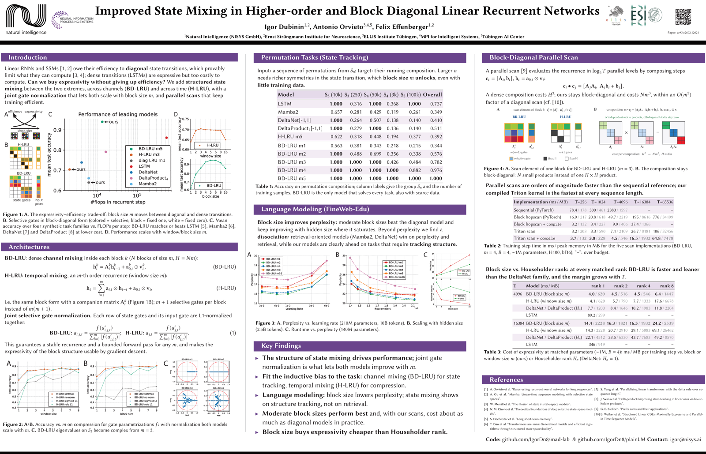

# Improved State Mixing in Higher-order and Block Diagonal Linear Recurrent Networks

**NeurIPS 2026** · [arXiv:2602.12021](https://arxiv.org/abs/2602.12021)

Igor Dubinin, Antonio Orvieto, Felix Effenberger

<p align="center">
  <a href="assets/neurips_poster.png"></a>
</p>

This repository contains the synthetic-task experiments, the BD-LRU / H-LRU layer implementations, their parallel-scan kernels, and the speed-benchmarking harness used in the paper. It is a fork of [MAD-Lab](https://github.com/athms/mad-lab) ([Mechanistic Design and Scaling of Hybrid Architectures](https://arxiv.org/abs/2403.17844)), which provides the synthetic-task training pipeline and the baseline primitives we build on.

### Project repositories

| Repository | Used for |
|------------|----------|
| **[mad-lab](https://github.com/IgorDn8/mad-lab)** (this repo) | Synthetic tasks (MAD suite + the new group state-tracking task), BD-LRU / H-LRU layers and scan kernels, iso-parameter / iso-state model configs, speed benchmarks |
| **[plainLM](https://github.com/IgorDn8/plainLM)** | Language-model pretraining and downstream evaluation of BD-LRU, H-LRU and the baselines at scale |

## Contents
- [What this repository adds](#what-this-repository-adds)
- [Installation](#installation)
- [Quick start](#quick-start)
- [Synthetic tasks](#synthetic-tasks)
    - [Group state-tracking tasks (new)](#group-state-tracking-tasks-new)
    - [Generating datasets](#generating-datasets)
    - [Original MAD tasks](#original-mad-tasks)
- [Models](#models)
    - [Scan implementations for BD-LRU / H-LRU](#scan-implementations-for-bd-lru--h-lru)
- [Layer configs and naming convention](#layer-configs-and-naming-convention)
- [Speed benchmarking](#speed-benchmarking)
- [Tests](#tests)
- [Repository structure](#repository-structure)
- [Citation](#citation)
- [Acknowledgements and license](#acknowledgements-and-license)

## What this repository adds

Relative to upstream MAD-Lab, this fork adds:

- **Models:** BD-LRU (`bdlru-sel-*`), H-LRU (`hlru-sel-*`), PDSSM (`pdssm-*`), an LSTM baseline (`lstm-*`), Mamba2 (`mamba2-fla-*`), DeltaNet (`dnet-*`) and DeltaProduct (`dproduct-*`). See [Models](#models).
- **A synthetic state-tracking task** based on the word problem on finite groups: `group-S` (symmetric group), `group-Z` (cyclic group) and `group-A` (alternating group). See [Group state-tracking tasks](#group-state-tracking-tasks-new).
- **Several scan implementations** for the linear-recurrent layers, from a sequential reference loop to hand-written Triton kernels, selectable at run time. See [Scan implementations](#scan-implementations-for-bd-lru--h-lru).
- **Iso-parameter and iso-state model tiers**, generated from one script, so that families can be compared at a matched parameter budget or a matched recurrent state size. See [Layer configs and naming convention](#layer-configs-and-naming-convention).
- **A speed-benchmarking harness** for throughput, latency and memory across sequence length, block size, batch size and hidden size. See [Speed benchmarking](#speed-benchmarking).
- A `uv`-based environment and vendored finite-group utilities for the group tasks.

## Installation

The project is managed with [uv](https://docs.astral.sh/uv/). Install it if needed:
```bash
curl -LsSf https://astral.sh/uv/install.sh | sh
```

Create the environment from the lock file (this installs PyTorch, Triton and everything needed for BD-LRU, H-LRU, PDSSM, LSTM and the group tasks):
```bash
uv sync
```

Optional extras:

| Extra | Command | Enables |
|-------|---------|---------|
| `fla` | `uv sync --extra fla` | Mamba2, DeltaNet and DeltaProduct baselines via [flash-linear-attention](https://github.com/fla-org/flash-linear-attention) (prebuilt wheels, no CUDA build) |
| `cuda` | `uv sync --extra cuda` | The original MAD-Lab primitives that need compiled CUDA kernels (FlashAttention, `causal-conv1d`, `mamba-ssm`). These build against your local CUDA toolkit. |

Extras can be combined, e.g. `uv sync --extra fla --extra cuda`. Run every command through `uv run`, e.g. `uv run python -m train ...`.

A CUDA GPU is required for training. Layers whose optional dependencies are missing are skipped with a warning at import time, so the base install is enough for everything in the paper except the `fla`-backed baselines.

#### Notes on the `fla` baselines
- **Precision:** DeltaProduct requires bf16 and DeltaNet is run in bf16 as well. Use `--precision bf16` for `dnet-*`, `dproduct-*` and `mamba2-fla-*` layers. BD-LRU, H-LRU, PDSSM and LSTM are run with `--precision 32`.
- **Hopper GPUs (H100/H200) with Triton ≥ 3.4:** `fla`'s gated chunk backward is only numerically correct through [`tilelang`](https://github.com/tile-ai/tilelang) (see [fla#640](https://github.com/fla-org/flash-linear-attention/issues/640)), which is why `tilelang` is part of the `fla` extra.
- **Mamba2** is backed by `fla.layers.Mamba2` (Triton) rather than the `mamba_ssm` CUDA package. Mamba-2's core SSD scan is a Triton kernel in `mamba_ssm` too, so nothing is lost on the scan itself, and this avoids building CUDA extensions.

#### Validated environment
The layers in this fork were validated with Python 3.12, PyTorch 2.13 (CUDA 13), Triton 3.7, flash-linear-attention 0.5.x and tilelang 0.1.x on NVIDIA H100 GPUs. The exact versions `uv sync` installs are pinned in [uv.lock](uv.lock). The Triton scans require Triton ≥ 3.0 and a PyTorch with `torch.compile` and `associative_scan` support.

## Quick start

Training runs are launched through [train.py](train.py). A model is specified as a list of layer names (sequence mixers alternating with channel mixers); layer names are keys of the registry in [mad/registry.py](mad/registry.py) and correspond to files in [configs/layers/](configs/layers/).

Train a two-block BD-LRU model (block size 4, ~1M mixer parameters) on the symmetric-group task S5:
```bash
uv run python -m train --task group-S --vocab-size 5 --seq-len 16 \
  --layers bdlru-sel-wd4-d128-iso1m swiglu bdlru-sel-wd4-d128-iso1m swiglu \
  --precision 32 --log-base-path logs
```

The same with H-LRU, PDSSM, LSTM, or a `fla` baseline:
```bash
uv run python -m train --task group-S --vocab-size 5 --seq-len 16 --precision 32 \
  --layers hlru-sel-wd4-d128-iso1m swiglu hlru-sel-wd4-d128-iso1m swiglu

uv run python -m train --task group-S --vocab-size 5 --seq-len 16 --precision 32 \
  --layers pdssm-d128-iso1m swiglu pdssm-d128-iso1m swiglu

uv run python -m train --task group-S --vocab-size 5 --seq-len 16 --precision 32 \
  --layers lstm-d128-iso1m swiglu lstm-d128-iso1m swiglu

uv run python -m train --task group-S --vocab-size 5 --seq-len 16 --precision bf16 \
  --layers dnet-d128-iso1m swiglu dnet-d128-iso1m swiglu        # needs --extra fla
```

Useful arguments (see `get_args()` in [train.py](train.py) for the full list):

| Argument | Meaning |
|----------|---------|
| `--task` | Task name from the task registry (`group-S`, `in-context-recall`, …) |
| `--vocab-size`, `--seq-len` | Task size. For group tasks `--vocab-size` is the group degree `n` (see below). |
| `--num-train-examples`, `--num-test-examples` | Dataset sizes (defaults 12 800 / 1 280) |
| `--layers` | Layer names, in order |
| `--layer-overrides KEY=VALUE ...` | Override config entries of all layers that accept them, e.g. `implementation=triton_auto_v2_compile` or `window_dim=4` |
| `--dim` | Model width; inferred automatically from the `-d<width>-` tag in layer names |
| `--precision` | `32` for BD-LRU / H-LRU / PDSSM / LSTM, `bf16` for the `fla` baselines |
| `--lr`, `--weight-decay`, `--epochs`, `--batch-size` | Optimisation settings |
| `--seed` | Random seed (also selects the dataset, see [Generating datasets](#generating-datasets)) |
| `--log-base-path` | Where run directories are written. Each run gets a `results.csv` with final train / test metrics. |

Models can also be trained from Python with the `train(...)` function:
```python
from train import train
from mad.configs import MADConfig

model = ...  # any torch.nn.Module mapping (batch, seq_len) token ids to logits
results = train(model=model, mad_config=MADConfig(task='group-S', vocab_size=5, seq_len=16),
                log_path='./logs/my-model')
```

## Synthetic tasks

### Group state-tracking tasks (new)

The `group-S`, `group-Z` and `group-A` tasks are the word problem on a finite group, a standard probe of a model's ability to track state: every input token is an element of the group, and the target at position `t` is the product of all input elements up to `t` (the running prefix product). A model therefore has to maintain the current group element as its state and update it with every token.

| Task | Group | `--vocab-size n` means | Number of elements |
|------|-------|------------------------|--------------------|
| `group-S` | symmetric group S_n (permutations of n items) | degree `n` | `n!` (S5: 120) |
| `group-A` | alternating group A_n (even permutations) | degree `n` | `n!/2` (A5: 60) |
| `group-Z` | cyclic group Z_n | order `n` | `n` |

`group-S` with `n ≥ 5` is non-solvable, which is the case that separates architectures in the paper. `group-Z` is abelian and serves as an easy control. The model's actual vocabulary is the number of group elements, which `train.py` computes from `--vocab-size` automatically. Targets are predicted at every position.

The group arithmetic uses the finite-group utilities from [alreich/abstract_algebra](https://github.com/alreich/abstract_algebra) (MIT), vendored under [abstract_algebra/](abstract_algebra/) because the project is not on PyPI. The task implementation is in [mad/data/instances.py](mad/data/instances.py) (`generate_group_*_instance`, with the group built once and cached).

### Generating datasets

`train.py` derives a dataset directory from the task arguments and seed (via `mad.paths.make_dataset_path`, under `--data-path`, default `./data`), and generates the data on the first run if the directory does not exist. Datasets can also be generated ahead of time, which is faster for the group tasks and lets several training runs share one dataset.

Group tasks (builds the group once per seed and draws train / test sequences without replacement, so the two splits are disjoint):
```bash
uv run python -m scripts.generate_group_data \
  --task group-S --vocab-size 5 --seq-len 16 \
  --num-train-examples 100000 --num-test-examples 1280 \
  --seeds 12345 42 43
```

Original MAD tasks (a fixed set of task / size combinations is built in; use the flags to generate a single custom dataset instead):
```bash
uv run python -m scripts.generate_synth_data --seeds 42 43 12345

uv run python -m scripts.generate_synth_data \
  --task in-context-recall --vocab-size 16 --seq-len 128 \
  --num-train-examples 20000 --num-test-examples 1280 --seeds 42
```

Datasets are stored as `inputs.npy` / `targets.npy` under `<data-path>/<task-dir>/{train,test}/`. A subsequent `train.py` call with the same task arguments and seed picks the dataset up automatically.

### Original MAD tasks

The six MAD tasks are kept unchanged from upstream and are described in the [MAD paper](https://arxiv.org/abs/2403.17844). Briefly:

- `in-context-recall`: retrieve the values of keys that appeared earlier in the sequence (multi-query associative recall).
- `fuzzy-in-context-recall`: in-context recall with keys and values made of a variable number of adjacent tokens.
- `noisy-in-context-recall`: in-context recall with noise tokens from a separate vocabulary interleaved between the pairs.
- `selective-copying`: copy a set of tokens, in order, to a later position while ignoring randomly inserted noise tokens.
- `compression`: compress a token sequence into one aggregation token from which an MLP has to recover the sequence.
- `memorization`: learn a fixed key-value mapping from the training data.

The baseline settings and difficulty changes of the upstream MAD protocol are kept in [configs/tasks/](configs/tasks/) for reference; the protocol runner itself is not part of this repository.

## Models

All models used in the paper's synthetic experiments are sequence-mixing layers registered in [mad/registry.py](mad/registry.py). Channel mixers (`swiglu`, `mlp`) come from upstream.

| Family | Layer name pattern | Implementation | Size knobs | Precision | Extra |
|--------|--------------------|----------------|------------|-----------|-------|
| **BD-LRU** (block-diagonal LRU, selective) | `bdlru-sel-wd{m}-d{d}-...` | [bdlru_sel.py](mad/model/layers/bdlru_sel.py) | `hidden_dim` (number of blocks `N`), `window_dim` (block size `m`) | `32` | — |
| **H-LRU** (higher-order LRU, selective) | `hlru-sel-wd{m}-d{d}-...` | [hlru_sel.py](mad/model/layers/hlru_sel.py) | `hidden_dim`, `window_dim` (recurrence order `m`) | `32` | — |
| PDSSM | `pdssm-d{d}-...` | [pdssm.py](mad/model/layers/pdssm.py) | `hidden_dim`, `dictionary_size` | `32` (complex-valued) | — |
| LSTM | `lstm-d{d}-...` | [lstm.py](mad/model/layers/lstm.py) | `hidden_dim` | `32` | — |
| Mamba2 | `mamba2-fla-d{d}-...` | [mamba2_fla.py](mad/model/layers/mamba2_fla.py) | `expand`, `state_size`, `head_dim` | `bf16` | `fla` |
| DeltaNet | `dnet-d{d}-...` | [deltanet.py](mad/model/layers/deltanet.py) | `num_heads`, `head_dim` | `bf16` | `fla` |
| DeltaProduct | `dproduct-hh{r}-d{d}-...` | [deltaproduct.py](mad/model/layers/deltaproduct.py) | `num_heads`, `head_dim`, `rank` (number of Householder reflections `r`) | `bf16` | `fla` |

**BD-LRU and H-LRU.** Both layers keep a recurrent state of `N` blocks of size `m` (state size `N·m`) and compute the transition of each block from the input through a selective gate. In BD-LRU each block is a dense `m × m` transition; in H-LRU each block is the companion matrix of an order-`m` recurrence. `m = 1` recovers a diagonal (scalar-gated) linear recurrence. Non-selective variants are in [bdlru_nonsel.py](mad/model/layers/bdlru_nonsel.py) and [hlru_nonsel.py](mad/model/layers/hlru_nonsel.py).

**Baselines.** DeltaNet and DeltaProduct are the gated variants with negative eigenvalues allowed (`gated: true`, `negative: true` in their configs). The number of Householder reflections in DeltaProduct plays the role that the block size plays for BD-LRU / H-LRU, so both are swept as a first-class axis. Mamba2 uses the Triton SSD kernels from `fla`.

The upstream MAD-Lab primitives (attention, Hyena, Mamba-1, linear and gated linear attention, RWKV-5/6) remain available and are listed in [mad/registry.py](mad/registry.py); most of them need the `cuda` extra.

### Scan implementations for BD-LRU / H-LRU

The recurrence of BD-LRU / H-LRU can be evaluated by several interchangeable implementations, selected with `--layer-overrides implementation=<name>` (the default in the config files is `orig`):

| `implementation` | Description |
|------------------|-------------|
| `orig` | Sequential PyTorch loop over time. Reference implementation; slowest at long sequence length. |
| `affine_scan_torch_impl` | `torch.associative_scan` over the affine recurrence ([affine_scan.py](mad/model/layers/ops/scans/affine_scan.py)). |
| `hopscan_custom`, `custom_hopscan_autotune` | Eager parallel scan with a hand-written autograd function ([hopscan.py](mad/model/layers/ops/scans/hopscan.py)). |
| `triton_sequential`, `triton_persistent`, `triton_parallel_blelloch`, `triton_chunked` | Fixed Triton kernels ([triton_scans.py](mad/model/layers/ops/scans/triton_scans.py)). |
| `triton_auto`, `triton_auto_v2`, `triton_auto_v2_compile` | Occupancy-aware dispatch between the Triton kernels ([triton_auto_scan.py](mad/model/layers/ops/scans/triton_auto_scan.py)); `v2` adds a fused backward ([triton_fused_bwd.py](mad/model/layers/ops/scans/triton_fused_bwd.py)) and `_compile` hands the surrounding gate pipeline to `torch.compile`. |
| `triton_fused_gates` | Gating fused into the scan kernel so the transition tensor is never materialised ([triton_fused_gate_scan.py](mad/model/layers/ops/scans/triton_fused_gate_scan.py)). Currently `m = 1` only; wider blocks fall back to `triton_auto_v2_compile`. |

All implementations compute the same function; the fastest choices are `triton_fused_gates` at `m = 1` and `triton_auto_v2_compile` otherwise. The parallel implementations reassociate the recurrence, so they should be run at `--precision 32`. Pass/fail numerical tests are in [tests/test_scans.py](tests/test_scans.py); a quantitative forward / backward error table against a float64 reference is produced by
```bash
uv run python -m scripts.verify_scans --dtypes float32 bfloat16 --out results/verify/errors.csv
```

## Layer configs and naming convention

Every registered layer name maps to a YAML file in [configs/layers/](configs/layers/) holding the keyword arguments of the layer class, for example:
```yaml
# configs/layers/bdlru-sel-wd4-d128-iso1m.yml
dim: 128
hidden_dim: 277
window_dim: 4
implementation: orig
```

Names are built from the family prefix and dash-separated tags:

| Tag | Meaning | Families |
|-----|---------|----------|
| `d{d}` | Model width `dim` (`train.py` sets `--dim` from it) | all |
| `wd{m}` | Block size / recurrence order `window_dim` | BD-LRU, H-LRU |
| `h{N}` | `hidden_dim` (number of blocks for BD-LRU / H-LRU, hidden size for LSTM / PDSSM) | BD-LRU, H-LRU, LSTM, PDSSM |
| `hh{r}` | Number of Householder reflections (`rank`) | DeltaProduct |
| `hd{k}`, `nh{h}` | `head_dim`, `num_heads` | DeltaNet, DeltaProduct |
| `gn`, `gn{r}` | Gated + negative-eigenvalue variant (and rank `r`); hand-sized configs used for early comparisons | DeltaNet, DeltaProduct |
| `s{S}`, `e{x}`, `c{k}` | `d_state`, `expand`, `d_conv` | `mamba-v2-*` (Mamba-1 sweep, needs `cuda` extra) |
| `iso{B}` | **Iso-parameter tier**: size knob solved so the mixer has ~`B` parameters (`iso033m` ≈ 0.33M, `iso1m` ≈ 1M, `iso10m`, `iso33m`, `iso100m`) | all paper families |
| `s{S}` | **Iso-state tier**: size knob set so the recurrent state holds `S` scalars | all paper families |

Hand-sized configs such as `bdlru-sel-wd2-d128-h64` or `pdssm-d128-h128` are listed explicitly in the registry. The iso tiers are generated.

#### Iso-parameter tiers
For a fixed width `d` and a target sequence-mixer parameter budget, the size knob of each family is solved by binary search (verified by counting `parameters()`), so every family in a tier has the same mixer parameter count to within a few percent. Token embedding / unembedding parameters are identical for a fixed `(vocab, d)` and are not counted.

| Tag | `d` | Mixer budget |
|-----|-----|--------------|
| `iso033m` | 128 | ~0.33M |
| `iso1m` | 128 | ~1M |
| `iso1m` | 1024 | ~1M (Mamba2 excluded, its minimum is ~3.4M) |
| `iso10m` | 1024 | ~10M |
| `iso33m` | 1024 | ~33M |
| `iso100m` | 1024 | ~100M |

| Family | Layer name | Solved knob |
|--------|------------|-------------|
| LSTM | `lstm-d{d}-{tag}` | `hidden_dim` |
| BD-LRU, blocks `m ∈ {1,2,4,8,16}` | `bdlru-sel-wd{m}-d{d}-{tag}` | `hidden_dim` |
| H-LRU, orders `m ∈ {1,2,4,8,16}` | `hlru-sel-wd{m}-d{d}-{tag}` | `hidden_dim` |
| PDSSM | `pdssm-d{d}-{tag}` | `hidden_dim` |
| Mamba2 | `mamba2-fla-d{d}-{tag}` | `expand` (`state_size=128`, `head_dim=64`) |
| DeltaNet | `dnet-d{d}-{tag}` | `num_heads` (`head_dim=16`) |
| DeltaProduct, `r ∈ {2,4,8}` | `dproduct-hh{r}-d{d}-{tag}` | `num_heads` (`head_dim=16`) |

The generated configs and the index `configs/iso_param_sweeps.json` (which the registry reads to register them) are written by
```bash
uv run python -m scripts.gen_iso_param_sweeps          # solve every knob, write configs + index
uv run python -m scripts.gen_iso_param_sweeps --check   # solve and print (params, %err) only
uv run python -m scripts.param_count --layers bdlru-sel-wd4-d128-iso1m dnet-d128-iso1m   # count mixer params
```

Note that the budgets are matched but the precision is not: BD-LRU / H-LRU / PDSSM / LSTM run in fp32 and the `fla` baselines in bf16.

#### Iso-state tiers
These match the recurrent state size (the number of scalars carried across time) instead of the parameter count. State size per family: `hidden_dim` for LSTM and PDSSM, `hidden_dim × window_dim` for BD-LRU / H-LRU, `expand · d · state_size` for Mamba2, and `num_heads × head_dim²` for DeltaNet / DeltaProduct (independent of the number of Householder reflections). Tiers are generated at `d = 128` for `S ∈ {512, 1024, 2048, 4096}` and at `d = 1024` for `S = 4096`, with BD-LRU / H-LRU at `m ∈ {1,2,4,8,16}` and DeltaProduct at `r ∈ {2,4,8}`; names end in `-s{S}`, e.g. `bdlru-sel-wd4-d128-s2048`. The spec lives in `mad.registry.iso_state_layer_specs()` and the files are written by
```bash
uv run python -m scripts.gen_iso_state_configs          # write the YAMLs
uv run python -m scripts.gen_iso_state_configs --check   # print implied state sizes only
```
Parameter counts vary widely across families at a fixed state, and the smallest tiers make the matrix-state baselines degenerate (e.g. `state_size=2` for Mamba2 at `S=512`), so these rows should be read with care.

## Speed benchmarking

[speed_benchmark.py](speed_benchmark.py) measures forward+backward step time (median and IQR over repeats), tokens/s and peak memory for any registered layer, sweeping sequence length, block size, batch size or hidden size with automatic OOM back-off. Results go to `results/<name>/results.csv` and figures to `figures/<name>/`.

```bash
uv run python speed_benchmark.py \
  --layers bdlru-sel-wd1-d128-h128 \
  --layer-overrides implementation=triton_fused_gates \
  --sweep-key seq_len --sweep-values 512 1024 2048 4096 8192 16384 \
  --precision 32 --name bdlru-fused-gates
```

[scripts/run_comparison_suite.py](scripts/run_comparison_suite.py) runs the full set of regimes from the paper (length scaling at several block sizes, block-size, batch-size and hidden-size grids, inference-only, cross-model, and the iso-parameter / iso-state tiers over a batch × length grid) for every scan implementation, and renders the comparison figures. It is resumable: re-running only fills in missing cells.
```bash
uv run python -m scripts.run_comparison_suite --dry-run                 # list what would run
uv run python -m scripts.run_comparison_suite --regime blocksize        # one regime
uv run python -m scripts.run_comparison_suite --regime iso-d128-iso1m   # one iso tier
uv run python -m scripts.run_comparison_suite                           # every regime
```
The plotting helpers it uses ([plot_speed.py](scripts/plot_speed.py), [plot_compare.py](scripts/plot_compare.py), [plot_crossover.py](scripts/plot_crossover.py), [plot_grid.py](scripts/plot_grid.py), [plot_iso.py](scripts/plot_iso.py)) can also be run on their own on a results CSV; see the docstring at the top of each script.

## Tests

```bash
uv run python -m tests.test_datasets   # dataset generation for every task
uv run python -m tests.test_tasks      # short training runs per task
uv run python -m tests.test_layers     # every registered layer builds and trains
uv run python -m tests.test_scans      # all scan implementations agree with the reference
```
`test_layers` and `test_scans` need a GPU.

## Repository structure
```
train.py                   -> train one model on one task (main entry point)
speed_benchmark.py         -> throughput / latency / memory benchmark for registered layers
configs/
  layers/*.yml             -> one config per registered layer name
  tasks/*.yml              -> MAD task baselines and difficulty changes
  iso_param_sweeps.json    -> index of generated iso-parameter configs (read by the registry)
mad/
  registry.py              -> task and layer registries; iso-state spec
  configs.py               -> MADConfig / MADModelConfig dataclasses
  data/instances.py        -> instance generators for every task (incl. group-*)
  data/dataset.py          -> dataset generation / caching
  model/                   -> LanguageModel / AutoEncoder backbones and layers
  model/layers/            -> bdlru_sel.py, hlru_sel.py, pdssm.py, lstm.py, deltanet.py,
                              deltaproduct.py, mamba2_fla.py + upstream primitives
  model/layers/ops/scans/  -> scan implementations (torch, hopscan, Triton kernels)
  speed.py                 -> timing utilities for speed_benchmark.py
  helpers.py, paths.py, metrics.py
scripts/
  generate_group_data.py   -> pre-generate group-task datasets
  generate_synth_data.py   -> pre-generate MAD-task datasets
  gen_iso_param_sweeps.py  -> solve and write the iso-parameter configs
  gen_iso_state_configs.py -> write the iso-state configs
  param_count.py           -> count sequence-mixer parameters
  verify_scans.py          -> numerical error table for the scan implementations
  run_comparison_suite.py  -> full speed-benchmark suite
  plot_*.py                -> figures from speed-benchmark CSVs
abstract_algebra/          -> vendored finite-group utilities (MIT) for the group tasks
tests/                     -> dataset, task, layer and scan tests
assets/                    -> poster and images
```

## Citation

If you use this code, please cite the paper and the original MAD-Lab:

```bibtex
@misc{dubinin2026statemixing,
  title={Improved State Mixing in Higher-order and Block Diagonal Linear Recurrent Networks},
  author={Dubinin, Igor and Orvieto, Antonio and Effenberger, Felix},
  year={2026},
  eprint={2602.12021},
  archivePrefix={arXiv},
  primaryClass={cs.LG},
  url={https://arxiv.org/abs/2602.12021},
}

@misc{poli2024mechanistic,
  title={Mechanistic Design and Scaling of Hybrid Architectures},
  author={Poli, Michael and Thomas, Armin W and Nguyen, Eric and Ponnusamy, Pragaash and Deiseroth, Bj{\"o}rn and Kersting, Kristian and Suzuki, Taiji and Hie, Brian and Ermon, Stefano and R{\'e}, Christopher and Zhang, Ce and Massaroli, Stefano},
  year={2024},
  eprint={2403.17844},
  archivePrefix={arXiv},
  primaryClass={cs.LG},
  url={https://arxiv.org/abs/2403.17844},
}
```

## Acknowledgements and license

This repository is released under the MIT license (see [LICENSE](LICENSE)). It builds on [MAD-Lab](https://github.com/athms/mad-lab) and on the open-source implementations it integrates: [flash-linear-attention](https://github.com/fla-org/flash-linear-attention), [FlashAttention](https://github.com/Dao-AILab/flash-attention), [Mamba](https://github.com/state-spaces/mamba), [Hyena](https://github.com/HazyResearch/safari) and [RWKV](https://github.com/BlinkDL/RWKV-LM). The group tasks use [abstract_algebra](https://github.com/alreich/abstract_algebra) by Alfred J. Reich (MIT, vendored under [abstract_algebra/](abstract_algebra/) with its license).
